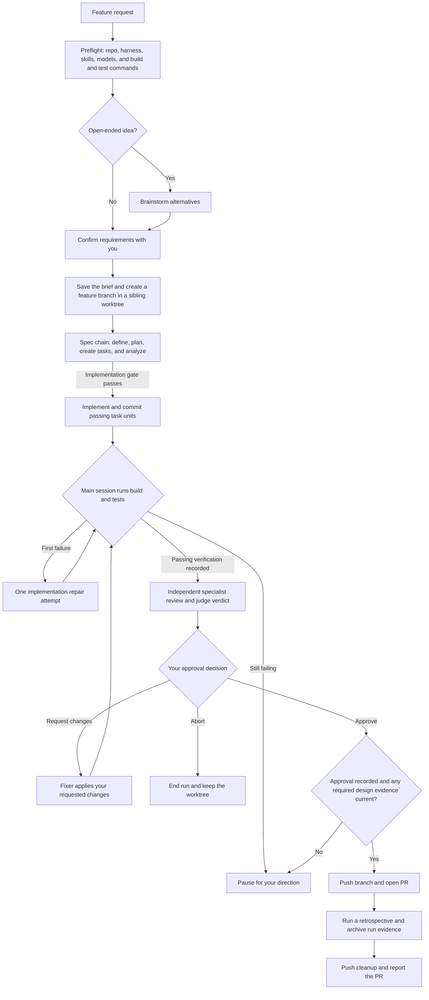
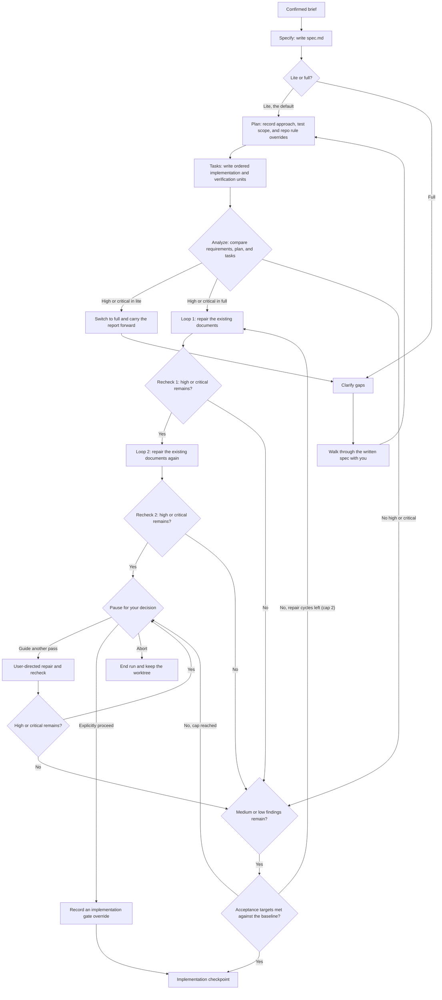
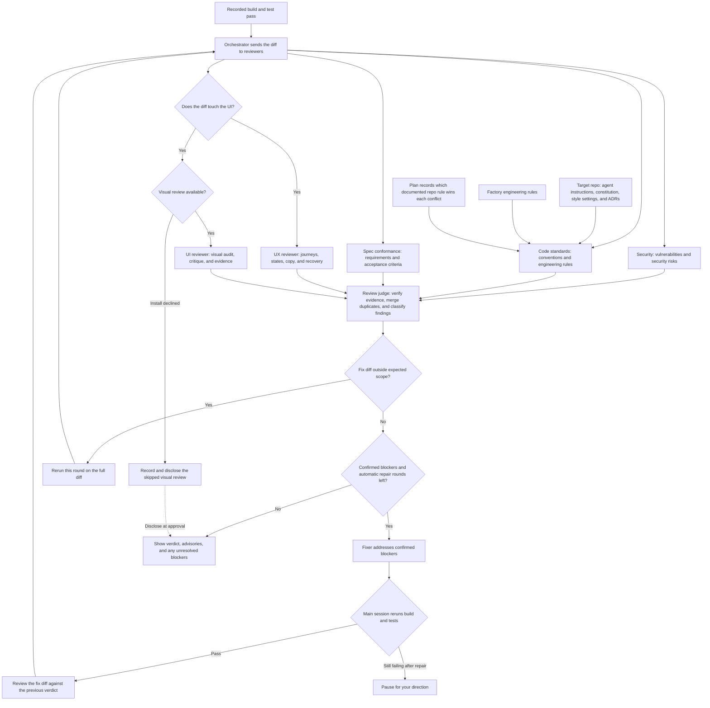

# Software Factory overview

The factory turns a feature brief into a reviewed pull request. The main agent session runs the workflow, specialists handle scoped work, and the Python CLI records decisions and checks that the run has the evidence it needs to advance.

## From request to pull request

The main session handles questions from specialists. Fast mode can accept eligible recommendations and records them for review. Initial requirements, protected decisions, and final approval stay with you. Publication on a design run requires current evidence or an explicit exception for the affected scope. A run can pause before a selected stage and resume from the worktree, saved answers, and completed commits. [Workflow](../core/skills/factory/SKILL.md) · [Question relay](../core/skills/factory/references/protocol.md) · [Resume behavior](../core/skills/factory/references/state.md#resume)

## Spec chain and Analyze repair loops

The initial Analyze precedes both repair loops and sets the baseline. Implementation waits until CRITICAL and HIGH are zero and the total and LOW counts meet the baseline-relative targets: each must be below half its baseline, and a zero baseline stays zero. Repair runs at most two cycles; after that the run pauses for your decision. When a repair needs a decision, the main session relays the question and returns to clarification before the recheck. The current loop repairs feature documents in place. A constitution change is applied only after you approve its exact draft ([ADR 0014](adr/0014-analyze-acceptance-targets.md)). [Current spec chain](../core/skills/factory/SKILL.md#5-spec) · [Spec builder](../core/roles/spec-builder.md)

## Independent specialist review

The first round covers the full diff. The judge can expand a later round back to a full review when the fix goes outside its expected scope. The factory allows up to two automatic review fixes. Required design evidence still goes through spec conformance if visual review is skipped. Approval discloses skipped review, static-only evidence, and unresolved findings. [Review workflow](../core/skills/factory/SKILL.md#7-review) · [Reviewer rules](../core/roles/code-standards.md) · [Judge](../core/roles/review-judge.md) · [Repo rule precedence](../core/skills/factory/references/engineering.md#rules)

## What owns decisions and evidence

| Component | Responsibility |
|---|---|
| Main session | Runs preflight, dispatches fresh roles, relays questions, runs independent checks, and opens the PR after approval. |
| Harness adapter | Maps factory operations to the host’s tools, model selection, agent format, and permissions. |
| Specialists | Produce scoped artifacts, implementation commits, review findings, or a judge verdict. |
| State CLI | Records checkpoints, answers, analysis counts, and verification. It requires settled analysis or a recorded override before implementation, passing verification before review, and recorded approval or an explicit override before PR entry. |
| Git worktree and archive | Hold the task commits and evidence used on resume. The run archive retains the audit record after PR creation and preserves deliverable design evidence in the project. |

The CLI validates recorded results. The main session runs the commands that produce them. [Transition checks](../core/skills/factory/bin/factory_cli/checks.py) · [State writer](../core/skills/factory/bin/factory_cli/state.py) · [Publication and archive](../core/skills/factory/SKILL.md#9-pr)

## Known gaps and planned work

The diagrams show the intended flow of the current implementation. Two UI instructions need repair. The orchestrator still refers to the old UI writer name, and the OpenCode reviewer’s delegation policy conflicts with the bundled standalone web critique. Both are documented in the [UI handoff plan](superpowers/plans/2026-11-03-factory-ui-handoffs-plan.md). Their live impact remains unverified.

- [Live end-to-end conformance](superpowers/plans/2026-11-03-factory-live-conformance-plan.md)
- [Bind publication to tested, reviewed, and approved work](superpowers/plans/2026-11-03-factory-publication-evidence-plan.md)
- [Collect feedback after PR creation](superpowers/plans/2026-11-03-factory-post-pr-feedback-plan.md)
- [Assign PRs to the signed-in GitHub account](superpowers/plans/2026-11-03-factory-pr-self-assignment-plan.md)
