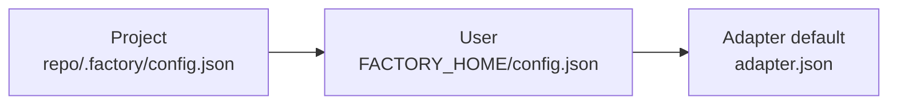

# Configuration

## Environment

| Variable | Meaning |
|---|---|
| `FACTORY_HOME` | Factory home, default `~/.factory`. Holds `pending/`, `archive/`, `improvements/`, `dist/`, `skills/`, `bin/`, `config.json`. Shared by every harness. |
| `FACTORY_HARNESS` | Force a specific adapter instead of auto-recognition. |

## Model resolution



For each tier (`deep`, `standard`) the first layer that sets a value wins. The result and its source are recorded in run state. Changes are disclosed on resume. Models are never silently replaced.

## User config

```json
{
  "models": {
    "claude-code": { "deep": "opus", "standard": "sonnet" }
  },
  "budget": {
    "default_s": 300,
    "roles": { "code-build": 900, "spec-builder": 600 }
  }
}
```

## Per-project models

`/factory init` seeds `<repo>/.factory/config.json` with effective values and a README. See what applies with:

```sh
python3 <factory-skill>/bin/factory models --json
```

A malformed config stops the run, names the file and says how to fix it.

## Modes and flags

| Flag | Effect |
|---|---|
| `--lite` / `--full` | Pick the spec chain. Lite is default. |
| `--fast` / `--no-fast` | Auto-accept recommended relay answers, or ask everything. Fast is default. |
| `--cruise` / `--no-cruise` | Unattended run to the approver. Never opens a PR without your Approve ([ADR 0014](../adr/0014-cruise-mode-overrides-protections-but-never-publishes.md)). |
| `--stop-at <stage>` | Pause before that stage. |

An unknown flag is never ignored. The factory names it and asks.

## Budgets

`budget.default_s` applies to every role without its own entry. A missing or invalid value falls back to 300 and never fails a run.
