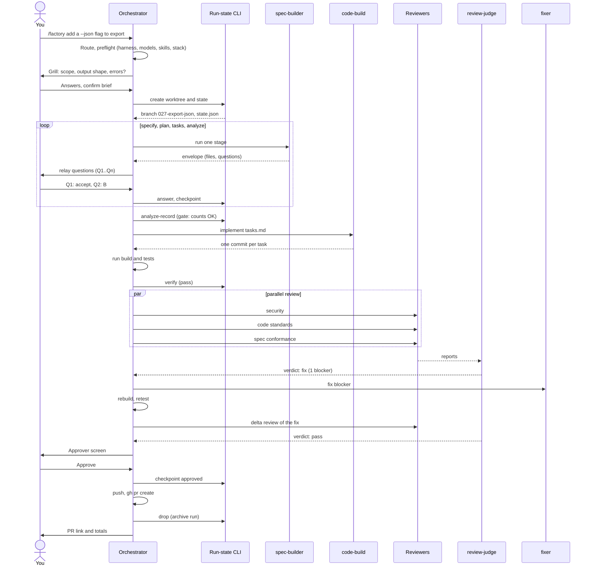

# Example run, end to end

!!! note "Illustrative"
    The feature, branch name and question IDs below are made up to show the shape of a run. Exact wording and numbers differ in a real run.

**Request:** `/factory add a --json flag to the export command`

## What you did

1. Wrote one sentence.
2. Answered the grilling interview and confirmed the brief.
3. Answered a few relay questions (fast mode took the rest).
4. Read the approver screen and chose **Approve**.

## What the factory did on its own

- Created an isolated branch and worktree.
- Wrote spec, plan and tasks, and gated on analyze.
- Committed one change per task, test first.
- Ran build and tests itself, twice.
- Fixed one blocker the judge confirmed, and re-reviewed only the fix.
- Opened the PR, archived the run, queued retro suggestions.

## What you would see if it went wrong

| Situation | What happens |
|---|---|
| Build stays red after one repair | Halt. You choose how to proceed. |
| Analyze still has HIGH findings after two loops | Halt. Guide a pass, proceed with a recorded override, or abort. |
| An agent hits its deadline | It returns `partial`. A fresh agent resumes from disk. |
| Your session dies | `/factory` lists the run. `/factory resume <branch>` continues. |

## After the PR

Check `/factory improve` for suggestions the retro agent wrote from this run's issues. Starting one is always your call.
