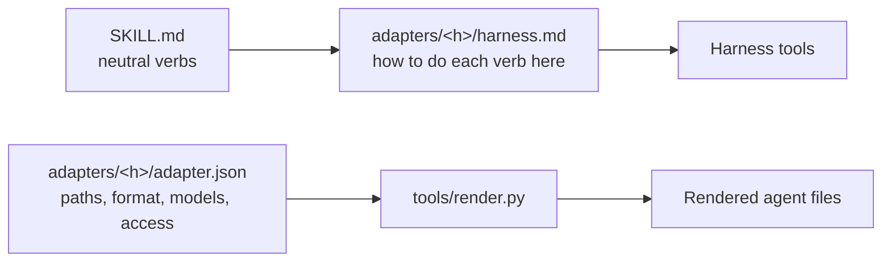

# Harnesses and adapters

The flow is written once, in neutral verbs. Each harness gets a thin adapter.

## Neutral verbs

`SPAWN`, `SPAWN_PARALLEL`, `ASK`, `NOTIFY`, `RESOLVE`, `SHELL`, `WEB_SEARCH`, `WEB_FETCH`. The orchestrator skill uses only these.

## Supported harnesses

| Harness | Install | Start | Agents installed to |
|---|---|---|---|
| Claude Code | `./install.sh` | `/factory` | `~/.claude/agents/factory-*.md` |
| OpenCode V2 | `--harness opencode` | `/factory` | `~/.config/opencode/agents/factory-*.md` |
| Codex | `--harness codex` | `$factory` | `~/.codex/agents/factory_*.toml` |
| GitHub Copilot | `--harness copilot` | `/factory` | `~/.copilot/agents/factory-*.agent.md` |
| ZCode | `--harness zcode` | `/factory` | `~/.zcode/agents/factory-*.md` |

## Capability tiers

An adapter declares how it can run roles: native subagents, headless subprocess, or inline. The approver screen tells you when the tier is not native subagents.

## Model pinning

Claude Code, Codex and OpenCode pin agent models by default. Copilot and ZCode inherit the session model. Codex, Copilot and ZCode cannot take a model at spawn time, so they run on the rendered selections.

## Add a harness

One new folder under `adapters/`: a `harness.md` describing how to recognise the harness and perform each verb, and an `adapter.json` with install paths, file format and defaults. Then `python3 tools/render.py --list` shows it.

## Rendered distribution

The repo's own `dist/` is the canonical render and is **not** tracked in git (CI checks this). Your install renders into `${FACTORY_HOME}/dist/<harness>/` with your overrides merged.
