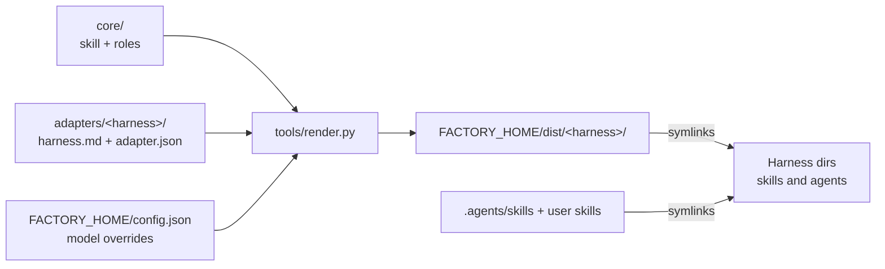

# Install and first run

## Requirements

- An agent harness with an adapter, and Python 3.
- In the repo you want to change: git, [SpecKit](https://github.com/github/spec-kit) (`.specify/`), and `gh` authenticated for the PR step.
- Required skills: `grilling`, `domain-modeling`, `pr`, `ponytail`, `tdd`. The bundled skill library provides them.

## Install

=== "Claude Code"

    ```sh
    ./install.sh
    ```

=== "OpenCode"

    ```sh
    ./install.sh --harness opencode
    ```

=== "Codex"

    ```sh
    ./install.sh --harness codex
    ```

=== "All harnesses"

    ```sh
    ./install.sh --harness all
    ```

The installer renders `core/` with the adapter into `${FACTORY_HOME:-~/.factory}/dist/<harness>/`, then symlinks the skill, skills and agents into the harness directories. Start a **new session** afterwards. Re-run after pulling.



## First run

1. Open a fresh session in the repo to change.
2. Run `/factory <feature>` (Codex: `$factory <feature>`). Describe behaviour and constraints.
3. Answer the grilling interview. Confirm the brief.
4. Answer relay questions by ID, for example `Q7: B` or `Q7: accept`.
5. Let it plan, implement, verify and review.
6. Choose **Approve** to open the PR.

## Commands

```text
/factory                              list unfinished runs
/factory <feature>                    new run (lite chain, fast mode)
/factory <feature> --full             full spec chain
/factory <feature> --no-fast          ask every relay question
/factory <feature> --cruise           unattended to the approver
/factory <feature> --stop-at review   pause before a stage
/factory resume <branch>              resume a run
/factory adopt <branch|spec_dir>      take over a spec written outside factory
/factory init                         seed <repo>/.factory/config.json
/factory improve                      list improvement backlogs
```

## Pause and resume

Pause with `--stop-at <stage>`, continue with `/factory resume <branch>`. After a crash, run `/factory` with no arguments to find unfinished runs. Resume rechecks models, skills and the stack profile, tells you what changed, and restarts the recorded stage from its start. Committed progress stays.
