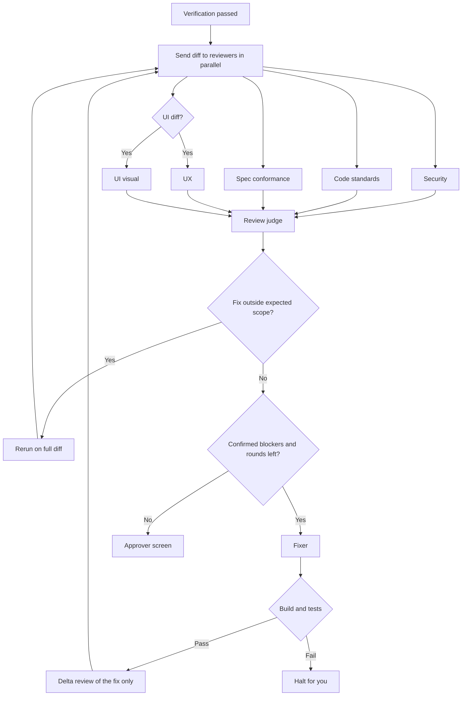

# Review and the fix loop

Review starts only after the orchestrator has recorded a passing build and test run.

## What each reviewer reads

- **Code standards** reads the repo's own agent instructions, constitution, style settings and ADRs, plus the factory's engineering rules. The repo's rules win, and the plan records each override. See [ADR 0020](../adr/0020-the-factory-discovers-repo-instructions-itself.md).
- **Spec conformance** checks the diff against requirements and acceptance criteria.
- **Security** looks for vulnerabilities.
- **UX / UI** run only when the diff touches UI. If you decline the visual-review install, the skip is recorded and shown at approval.

## The judge

Reviewers never decide the outcome. The judge:

1. Merges duplicates.
2. Verifies each finding against the code it reads itself.
3. Rates severity.
4. Sorts into `confirmed_blocking`, `advisory` or `rejected`.
5. Sets `verdict` to `fix` if any blocker is confirmed, else `pass`.

Judgement-call engineering rules are capped at advisory and never block ([ADR 0004](../adr/0004-judgement-call-rules-advise-they-never-block.md)).

## Fix rounds

- Up to **two** automatic fix rounds. Round 1 reviews the full diff. Later rounds review only the fix.
- If the fix touches files outside the expected scope, the judge sets `escalate` and the round reruns in full.
- After you choose **Request changes**, there is no round cap.

## What you see at approval

Verdict, advisory findings, unresolved blockers, skipped reviews, static-only evidence, and every auto-accepted answer.
