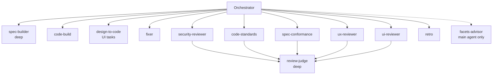

# Roles and who does what

A **role** is a prompt in `core/roles/`. The orchestrator spawns a fresh agent from it for one job, and the agent ends with an **envelope**: one fenced JSON block holding status, files and questions.

| Role | Job | Writes files? |
|---|---|---|
| `spec-builder` (deep) | Runs one SpecKit stage per spawn. | Yes (spec dir) |
| `code-build` | Implements `tasks.md`, one commit per task, test-first. | Yes |
| `design-to-code` | Implements `[UI]` tasks from a design source with rendered evidence. Also usable standalone. | Yes |
| `fixer` | Applies confirmed review blockers or your requested changes. | Yes |
| `security-reviewer` | Vulnerabilities and security risks. | Read only |
| `code-standards` | Repo conventions and engineering rules (ENG-1..ENG-31). | Read only |
| `spec-conformance` | Requirements and acceptance criteria. | Read only |
| `ux-reviewer` | Journeys, states, copy, recovery. UI diffs only. | Read only |
| `ui-reviewer` | Visual audit and evidence. UI diffs only. | Read only |
| `review-judge` (deep) | Merges, dedupes, verifies findings into one verdict. | Read only |
| `retro` | After the PR, proposes up to three improvement candidates. | Backlog only |
| `facets-advisor` (deep) | Scores projects or income options on the FACETS checklist. Started by you, never by `/factory`. | Profile only |

## Tiers and access

- **Tier**: `deep` roles (`spec-builder`, `review-judge`, `facets-advisor`) get the stronger model. Everything else is `standard`.
- **Access**: `read` roles cannot edit files. The adapter turns this into harness permissions.

## The envelope

Every role ends with one `json` block. The orchestrator checks it with `factory envelope check <file>` before using it. A role that skips or breaks its envelope counts as a failure, and a second failure halts the run.

## Why fresh agents

A new agent per stage keeps context small, makes resume trivial, and means no reviewer sees the builder's reasoning. See [Review](review.md).
