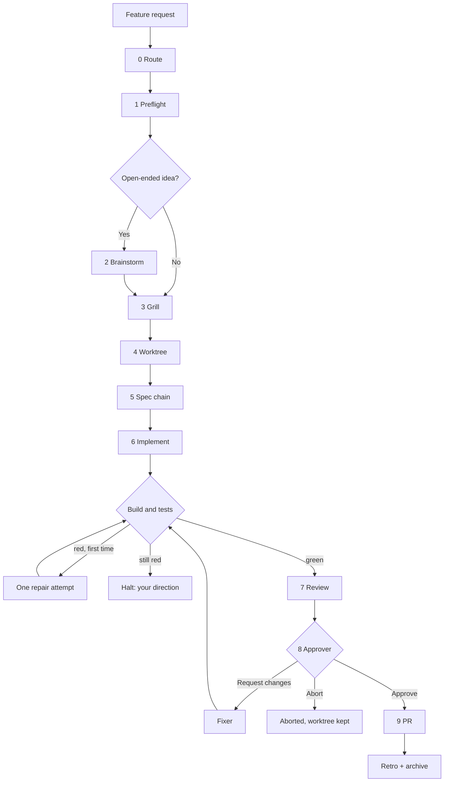

# The run, stage by stage

## 0. Route

Decide what you asked for: list runs, resume, `init`, `improve`, `adopt`, or a new request. A new request is classified as exploration, delivery or ambiguous. Ambiguous gets one question.

## 1. Preflight

- Pick the harness adapter and check required capabilities.
- Resolve models: project, then user, then adapter default.
- Resolve skills. Detect the stack from marker files (no network).
- Confirm build and test commands.

Nothing starts if a requirement is missing.

## 2. Brainstorm

Exploration only. Alternatives and trade-offs, saved as a brief.

## 3. Grill

A relentless interview until you confirm shared understanding. Writes `brief.md` and settles the spec chain. Grilling is always with you unless `--cruise` is on.

## 4. Worktree

Creates a numbered branch and a sibling worktree at `<repo>/../<repo-name>-factory/<branch>`. State moves from `${FACTORY_HOME}/pending/` into `specs/<branch>/factory/state.json`.

## 5. Spec

One fresh `spec-builder` per SpecKit stage. See [the spec chain](spec-chain.md).

## 6. Implement

`code-build` works through `tasks.md`, one commit per task. `[UI]` tasks go to `design-to-code`. The orchestrator then runs build and tests itself. A red build gets one repair attempt, then halts.

## 7. Review

Parallel reviewers, then the judge. See [Review](review.md).

## 8. Approver

You see: summary, diff stat, spec link, verdict, fix history, unresolved findings, run totals, and every fast-mode auto-answer for veto.

| Choice | Result |
|---|---|
| **Approve** | Opens the PR. |
| **Request changes** | Your text goes to the fixer, then verify and re-review with no round cap. |
| **Abort** | Marks aborted. Worktree stays. |

## 9. PR

Push, write the PR body with the `pr` skill, `gh pr create`, run the retro, archive the run, final push, show totals.

## Gates the CLI enforces

| To enter | Required evidence |
|---|---|
| implement | Analyze settled, or a recorded override |
| review | Passing verification recorded |
| pr | Recorded approval, or explicit override |

## When it halts

The factory stops and asks you when: CRITICAL/HIGH findings remain after two repair loops, a build stays red, an agent fails twice, or a stage stalls through three partial returns with no new commit. Your answer resumes, redirects or aborts.

## Time budgets

Each spawned role gets a deadline (default 300 s). File-writing roles stop at a safe commit boundary and return `partial`. A fresh agent resumes from disk. Reviewers and the judge are never stopped, only recorded.
