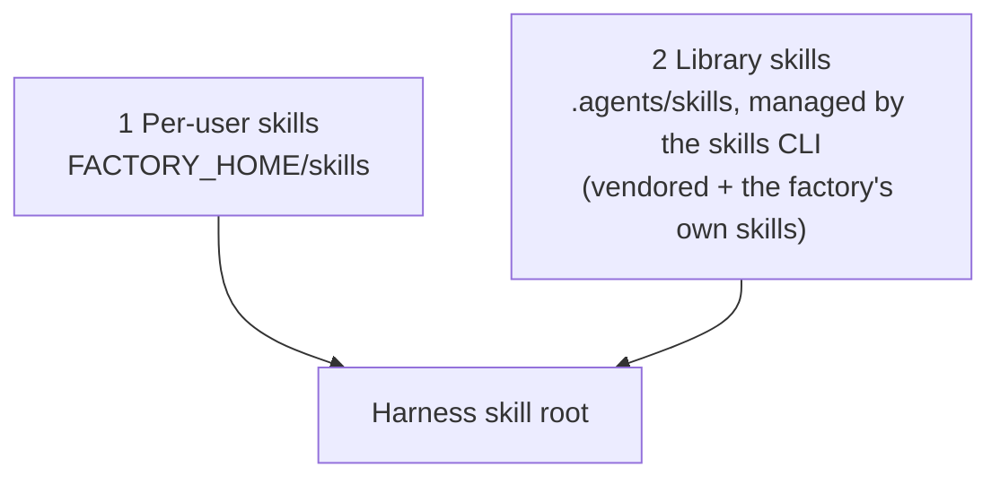
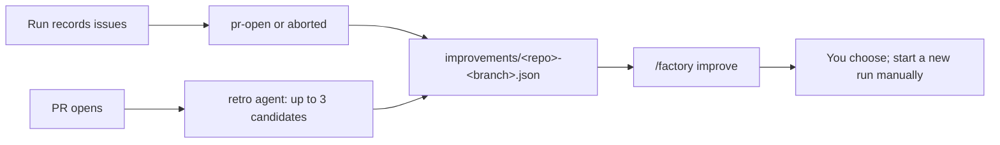

# Skills, design and self-improvement

## Skill library

The installer links two layers into each harness. On a name clash, the higher layer wins.



- Library skills carry provenance in `skills-lock.json` and licenses in `.agents/LICENSES/`.
- Add your own with `./install.sh --add-skill /path/to/name`. The folder needs a `SKILL.md` whose name matches the folder.
- See [ADR 0009](../adr/0009-library-skills-are-linked-not-rendered.md), [ADR 0018](../adr/0018-vendored-skills-are-managed-by-the-skills-cli.md), [ADR 0019](../adr/0019-factory-skills-are-local-library-entries.md).

## Design-to-code

When a run has a UI design source (Pen `.pen`, Figma node, image, or text against existing code):

- `docs/design-code-map.json` maps design nodes to stable code anchors.
- `[UI]` tasks in `tasks.md` go to the `design-to-code` role.
- The design governs visuals. Required evidence is build/runtime, mapping and rendered comparison.
- Missing evidence leaves work partial or blocked. Only an explicit scoped exception from you lets it proceed, labelled unverified.

See [ADR 0010](../adr/0010-ui-design-work-gets-its-own-write-role.md).

## Self-improvement



The factory never starts an improvement run on its own.

## FACETS advisor

`facets-advisor` is a main agent you start directly. It scores projects or income options on six facets with cited web research, then ranks them pursue / investigate / drop. It writes your constraints to `${FACTORY_HOME}/facets-profile.md` only after you confirm.

## Benchmark

```sh
python3 tools/bench.py run --harness opencode --bench greet-001
python3 tools/bench.py score <state.json>
python3 tools/bench.py compare before.json after.json
```

Replays a pre-settled feature in a disposable repo and scores it, so you can compare factory versions. It spends model tokens. See the [benchmark guide](../benchmark.md).
