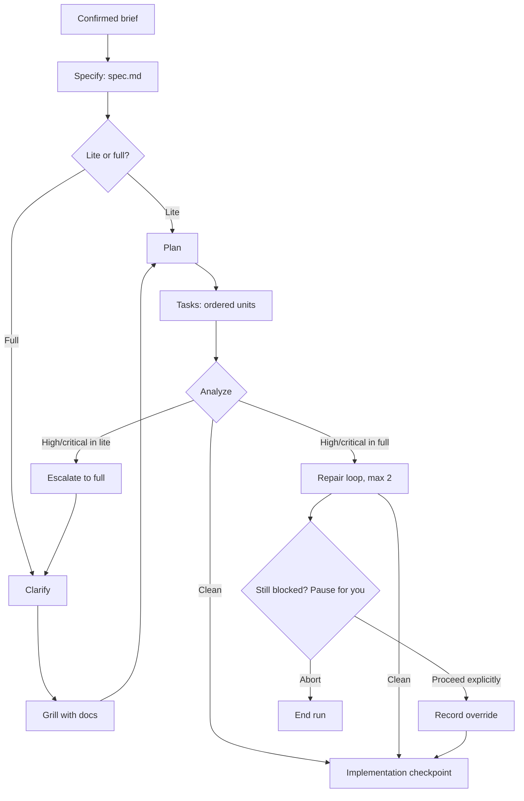

# The spec chain

The spec chain turns the confirmed brief into documents the code builder can follow. It runs on [SpecKit](https://github.com/github/spec-kit).

## Lite and full

| Chain | Stages | When |
|---|---|---|
| **Lite** (default) | specify, plan, tasks, analyze | Most features. One pass, no loop. |
| **Full** | specify, clarify, grill-with-docs, plan, tasks, analyze, plus a bounded analyze/remediate loop | Large or risky features. |

Lite escalates to full on its own when analyze reports any CRITICAL or HIGH finding.

## The implementation gate

Implementation waits until:

- CRITICAL and HIGH counts are zero, and
- total and LOW counts are each below half their baseline (a zero baseline stays zero).

The first analyze sets the baseline. Repair runs at most two cycles. After that, you decide. See [ADR 0016](../adr/0016-analyze-acceptance-targets.md).

## Questions from agents

Spec agents cannot talk to you. They return a batch of questions. The orchestrator **relays** the batch, you answer by ID, and a fresh agent continues the same stage. Fast mode auto-accepts eligible recommendations and lists each for your veto at approval. Protected design decisions and every halt always reach you.

## Adopting an outside spec

`/factory adopt <branch|spec_dir>` continues a SpecKit spec written elsewhere. It previews first, asks for the entry stage (at most `analyze`), then creates the worktree and one `factory: adopt` commit. See [ADR 0017](../adr/0017-adopted-runs-enter-at-most-at-analyze.md).
