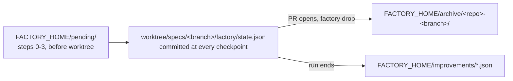

# Run state and the CLI

One run is one `state.json`. It is the single source of truth for where the run is.

## Where state lives



## What it records

| Field | Meaning |
|---|---|
| `stage`, `status` | Where the run is. Status: `running`, `waiting_user`, `paused`, `halted`, `aborted`, `pr-open`. |
| `mode` | Chain (`lite` or `full`), `fast`, optional `cruise`. |
| `models` | Resolved model per tier and where each came from. |
| `relay`, `decisions` | Open question round and the append-only list of settled answers and gate decisions. |
| `timeline` | Every wait on you, with latency. |
| `ledger` | One entry per agent spawn: timing, estimated and reported tokens. |
| `issues` | Everything that went wrong: overrun, agent-failure, retry, halt, verify-fail. |
| `history` | Append-only transitions: complete, verify-pass, approved, resumed... |
| `analyze` | Report paths, counts, baseline, loop count. |

## The CLI is the only writer

```sh
python3 <factory-skill>/bin/factory
```

Agents never edit state by hand. Every change goes through the CLI, which time-stamps, validates, writes atomically and commits.

| Group | Commands |
|---|---|
| Read | `runs`, `show`, `validate`, `resume`, `budget`, `models`, `improvements`, `detect` |
| Run state | `checkpoint`, `analyze-record`, `ledger-add`, `issue-add`, `wait-open`, `wait-close`, `answer`, `set-status`, `decisions-add`, `verify` |
| Lifecycle | `init`, `drop`, `rebind`, `prune`, `lock take` |
| Agents | `envelope check <file>` |

## Exit codes

| Code | Meaning |
|---|---|
| 0 | Success |
| 1 | No run, or refused |
| 2 | Not a git repository |
| 3 | Ambiguous run name |
| 4 | Recorded worktree gone |
| 5 | Usage error |

## Locks and moving a run

A live lock held by another session blocks writes. If you move or copy a worktree, run `factory rebind <branch> --worktree <new-path>` to rewrite the stored paths. See [ADR 0006](../adr/0006-no-manual-write-fallback-for-run-state.md) and [ADR 0008](../adr/0008-run-artifacts-leave-the-branch-at-pr-open.md).
