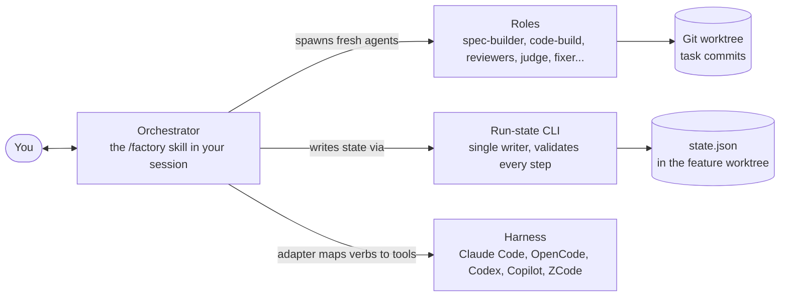
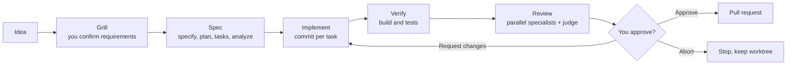

# What the factory is

The factory turns a feature description into a reviewed pull request. It is not a program that runs by itself. It is an **orchestrator skill** that your coding agent (the *harness*) loads, plus a set of **roles** it hands scoped work to, plus a small **Python CLI** that records what happened.

## The three layers

| Layer | What it is | Why it exists |
|---|---|---|
| Orchestrator | The agent session running `/factory`. The only participant that talks to you. | One place owns the flow, the questions and the approval gate. |
| Roles | Prompts the orchestrator spawns as fresh agents, one job each. | Small context, scoped work, independent review. |
| CLI | `core/skills/factory/bin/factory`, stdlib Python. | Agents forget and drift. The CLI does not. It refuses illegal transitions. |
| Adapter | A folder per harness in `adapters/`. | The flow stays the same on every harness. Only the tool names change. |

## What a run does, in one picture

## What it will not do

- It will not push before **Approve**. It never merges or deploys.
- It will not edit run state by hand. There is no manual fallback ([ADR 0006](../adr/0006-no-manual-write-fallback-for-run-state.md)).
- It will not install a missing capability on its own. Missing items are reported.

## Why it is built this way

- **Fresh agent per stage** keeps context small and stops one agent grading its own work.
- **Orchestrator runs the commands.** Build and test results come from the orchestrator, never from a role's claim.
- **State is a file.** A crash loses nothing that was committed.

The editable architecture sketch is [`docs/factory-core-and-loop.excalidraw`](https://github.com/tenluap/claude-factory/blob/main/docs/factory-core-and-loop.excalidraw). Open it at excalidraw.com.

!!! tip "Vocabulary"
    Terms like *stage*, *relay*, *envelope* and *verdict* have fixed meanings. See the [glossary](glossary.md).
