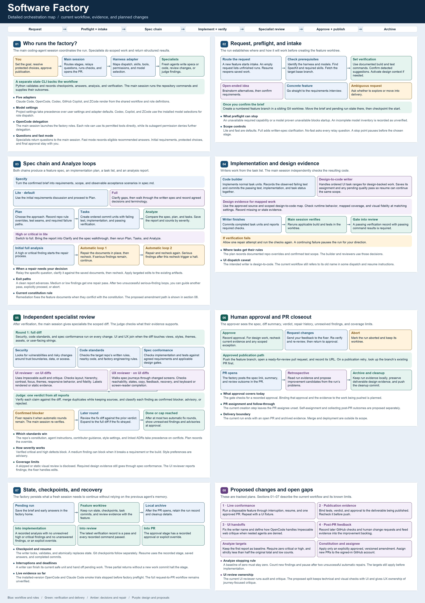

# Agent Factory

A software factory for coding-agent harnesses. You describe a feature. The factory interviews you, writes a spec, builds it, reviews it with independent specialists, and opens a pull request only after you approve.

## Start here

| If you want to... | Read |
|---|---|
| Understand the idea in five minutes | [What the factory is](guide/what-is-the-factory.md) |
| Run your first feature | [Install and first run](guide/install-and-first-run.md) |
| See every stage and gate | [The run, stage by stage](guide/run-lifecycle.md) |
| Know who does what | [Roles](guide/roles.md) |
| Tune models, budgets and modes | [Configuration](guide/configuration.md) |
| Understand a design choice | [Decisions (ADRs)](adr/0001-factory-owns-its-engineering-rules.md) |

## Three promises

1. **Nothing ships without you.** The factory never pushes, merges or deploys until you choose **Approve**.
2. **Every run is resumable.** State lives on disk. Close the session, switch harness, come back later.
3. **Evidence, not claims.** The orchestrator runs build and tests itself. A CLI refuses to advance a run that lacks the evidence.
